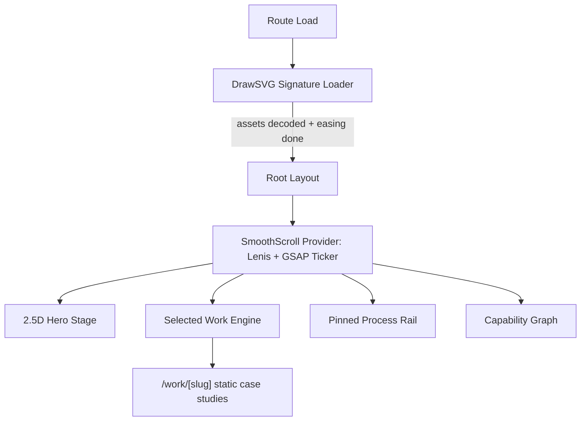

# RAJ SHAH — *Obsidian Lime Painted Portfolio*

**A design-led portfolio engineered like a product.**
Every animation has a job. Every pixel has a reason. Every project is data.

<br/>


`DESKTOP-FIRST` · `CLS = 0.0` · `ZERO WEBGL` · `FULL AI-CRAWLER VISIBILITY`


---

I built this site to answer one question for recruiters and engineering leads in under ten seconds: **can this person design it, engineer it, and ship it?** The repo is the proof.

---

## `01` &nbsp; THREE HATS, ONE CODEBASE

| | **PRODUCT DEVELOPER** | **WEB DEVELOPER** | **UI/UX DEVELOPER** |
|:--|:--|:--|:--|
| **Question I ask** | Who is this for, and what should they do next? | How do I make it fast, typed, and impossible to break? | How should this *feel* in the hand? |
| **Shown here as** | Audience-first scope: desktop evaluators. Case studies built as a pipeline, not pages. | Next.js 15 App Router, React 19, strict TypeScript, Zod-validated content, static generation. | Motion with purpose: tactile buttons, spatial continuity, a single design language. |
| **Evidence** | Data-driven registry · prev/next pagination · SEO + AI discoverability | Unified animation loop · collision-free pinning · CLS 0.0 | Obsidian Lime system · 2.5D hero · magnetic and keycap physics |

---

## `02` &nbsp; DESIGN SYSTEM — *OBSIDIAN LIME*

High-contrast dark space, surgical typography, tactile borders, one luminescent accent.

```
 VOID BLACK        OBSIDIAN SURFACE    LINE WIREFRAME     ACID LIME
 #0A0A0B           #131316             #26262B            #C6FF3D
 ██████████        ██████████          ██████████         ██████████
 background        floating cards      structural lines   energy & focus
```

<table>
<tr>
<td width="25%" align="center"></td>
<td width="25%" align="center"></td>
<td width="25%" align="center"></td>
<td width="25%" align="center"></td>
</tr>
</table>

**Type stack**

```
DISPLAY      Syne · Clash Display          tracking -0.035em, heavy geometric
INTERFACE    Plus Jakarta Sans · Satoshi   open apertures, high legibility
TELEMETRY    JetBrains Mono                HUD chips, phase indices, coordinates
EDITORIAL    Instrument Serif (italic)     one soft flourish against hard type
```

**Optical polish**

- **Static film grain:** a fixed, zero-runtime SVG noise layer at `opacity: 0.018` removes banding in dark gradients with no GPU cost.
- **Keycap buttons:** `box-shadow: 0 4px 0 #8FB81E` that collapses on press, so UI feels mechanical.
- **Roll-text labels:** two stacked text layers inside an `overflow: hidden` mask, rolling up on hover.

---

## `03` &nbsp; EXPERIENCE MODULES

Nine interactions. Each one reduces cognitive load, gives feedback, or preserves spatial continuity.

### ▸ 01 · Kinetic Signature Loader
An SVG signature draws itself (GSAP DrawSVG) while a HUD counter (`000% → 100%`) tracks *real* asset readiness: fonts loaded and hero image decoded via `Image.decode()`. On completion, a lime pulse fires and the black curtain exits (`yPercent: -100`).
**Why it matters:** no layout shift (CLS 0.0) and a craft-first first impression instead of a spinner.

### ▸ 02 · 2.5D Depth Sandwich (Hero)
Six absolutely-positioned layers fake a 3D stage with plain CSS compositing:

```
 L6  ACTIONS      magnetic CTAs (80px pull radius)
 L5  CONNECTORS   live SVG dashed lines, shortest-path from cards to body anchors
 L4  HUD RETICLE  crosshair brackets lock onto the face
 L3  FRONT MASK   outlined "RAJ SHAH", clipped to the portrait via mask-image
 L2  PORTRAIT     cutout with bottom gradient fade
 L1  BACK TYPE    solid giant "RAJ SHAH"
```
**Why it matters:** the text appears to wrap *around* the subject, with no Three.js, no WebGL, and no dropped frames.

### ▸ 03 · Face Lock-On & Anatomical Connectors
Hover or tap the portrait and brackets snap from scaled-up, transparent to a precise lock. SVG connectors recompute trigonometry between strength cards and anchor points (shoulder, temple, collar).

### ▸ 04 · Magnetic Pull + Keycap Physics
`useMagnetic` attracts CTAs within 80px of the cursor. Click drops the button 3px as the shadow collapses to `0 1px 0`. Hover spawns a radial `clip-path` ripple from the exact pointer entry point.

### ▸ 05 · Two-Tier Roll-Text
Navigation and button labels translate `-100%` while a duplicate rolls in. Small detail, obsessive finish.

### ▸ 06 · Cursor-Follower Project Preview
Hovering a project row dims its neighbours to `0.3` and spawns a glass preview card that trails the cursor (`gsap.quickTo`, 280ms exponential decay). All projects can be scanned in seconds with no page transitions.

### ▸ 07 · Pinned Horizontal Rail — *How I Work*
Vertical scroll locks and scrubs five cards across the viewport: **Observe → Explore → Shape → Build → Ship**. The focused card rotates to `0deg`, scales to `1.0`, and lights its lime anchor while the progress line syncs in both directions.

### ▸ 08 · System Capability Graph
A node map of frontend, backend and runtime, dev tooling, and design systems. Nodes carry status (`shipped` · `in-progress` · `learning`) and cross-link to the projects that used them. Keys `1`–`9` switch categories.

### ▸ 09 · Unified Smooth-Scroll Loop
Lenis and GSAP share one heartbeat (see below).

---

## `04` &nbsp; ENGINEERING — *PROBLEMS SOLVED*



### Challenge 1 · Two scroll engines fighting for the frame
**Problem:** smooth scrolling and scroll-triggered animation running on separate loops cause micro-stutter and tearing in scrubbed sections.
**Solution:** one clock. `gsap.ticker` drives Lenis directly (`lenis.raf(time * 1000)`), with `lagSmoothing(0)` to stop jump-cuts after tab switches. Easing uses `Math.min(1, 1.001 - 2^(-10t))`.

### Challenge 2 · Pinning that crashes React on navigation
**Problem:** GSAP's pin reparents the section node, so React later fails to unmount it with `removeChild` errors during route changes.
**Solution:** the **inner-wrapper pin pattern**. `pin: pinWrapperRef.current` pins a child inside `<section ref={sectionRef}>`, so React's root node is never reparented.

### Challenge 3 · Scrub distance that works on every monitor
**Problem:** a hard-coded horizontal travel distance breaks across resolutions.
**Solution:** distance is computed live as `track.scrollWidth - viewport.clientWidth`, so the rail fits any screen.

### Challenge 4 · A loader that is honest
**Problem:** fake progress bars lie, and late images cause layout shift.
**Solution:** progress reflects actual font readiness and `Image.decode()` completion. The curtain only leaves when the page is truly ready.

### Challenge 5 · 3D depth without 3D cost
**Problem:** WebGL for a hero is heavy and slow to start.
**Solution:** layered DOM plus `mask-image` on the portrait's alpha channel, entirely GPU-composited.

---

## `05` &nbsp; ZERO-BOILERPLATE PROJECT PIPELINE

Case studies, metrics, URLs, and media are **typed data**. No page is ever hand-built.

```
src/content/projects/
├── arc.ts               # visual DSA tracker
├── devintel.ts          # GitHub intelligence dashboard
├── alchemy-stories.ts   # botanical WebAR commerce
├── brewnest.ts          # cafe table booking
├── ghar.ts              # traditional culinary editorial
├── fintrack.ts          # vanilla JS financial analytics
└── index.ts             # dynamic registry + sorters
```

Add or delete one `.ts` file and the system updates:

```
 ✔ Home page featured-work rows
 ✔ /work/[slug] pages (generateStaticParams)
 ✔ Prev / Next chronological pagination
 ✔ Dynamic OpenGraph cards
 ✔ /sitemap.xml
 ✔ JSON-LD structured data
 ✔ /llms.txt and /llms-full.txt
```

---

## `06` &nbsp; FOUND BY HUMANS *AND* MACHINES

- **Structured data:** `WebSite`, `Person`, `SoftwareApplication` per case study, and `BreadcrumbList`.
- **AI-readiness:** `/llms.txt` is a dense index for reasoning engines. `/llms-full.txt` is the full dossier of projects, trade-offs, and architecture decisions.
- **Crawler policy:** a custom `robots.ts` with permissive rules for search and AI crawlers.

---

## `07` &nbsp; HONEST CONSTRAINT — *DESKTOP FIRST*

This is a deliberate product decision, not an oversight.

- **Pointer-dependent mechanics:** magnetic pull, cursor-lerp previews, and face targeting need a real pointer.
- **Canvas needs room:** the 6-layer hero, pinned rail, and capability graph are tuned for **1024px+** viewports.
- **Scroll physics:** Lenis-to-GSAP wheel behaviour is tuned for mice and precision trackpads.

Mobile gets vertical fallbacks and remains functional, but the experience is optimized for the audience that reviews engineers: desktops and laptops.

---

## `08` &nbsp; TECH STACK

| Layer | Tools |
|:--|:--|
| **Framework** | Next.js 15 (App Router, Server Components), React 19 |
| **Language & Validation** | TypeScript 5.8, Zod |
| **Styling** | Vanilla CSS tokens, Tailwind CSS v4 (`@theme`) |
| **Animation** | GSAP 3.12 (ScrollTrigger, DrawSVG), Motion (`motion/react`) |
| **Scroll** | Lenis 1.1 on the GSAP unified ticker |
| **Icons** | Lucide React |
| **Fonts** | `next/font/google`: Plus Jakarta Sans, Syne, JetBrains Mono |

---

## `09` &nbsp; RUN IT

```bash
pnpm install        # dependencies
pnpm dev            # dev server (clears stale cache)
pnpm build          # production build, all routes statically rendered
pnpm start          # preview the production build
pnpm tsc --noEmit   # type-check every route
```

---

## `10` &nbsp; MORE FROM ME

| Project | What it is |
|:--|:--|
| **ARC** | Visual DSA tracker and scrapbook |
| **DEVIntel** | GitHub intelligence dashboard |
| **Alchemy Stories** | WebAR botanical commerce |
| **Brewnest · GHAR · FinTrack** | Booking system · culinary editorial · vanilla JS analytics |

---

<div align="center">

```
 > connect --open-to internships, freelance
```

[](https://github.com/rajshahdev966)
[](https://www.linkedin.com/in/rajshah-dev)
[](https://x.com/rajshahdev966)

<sub>Built with precision and purpose. Crafted in dark mode.</sub>

</div>